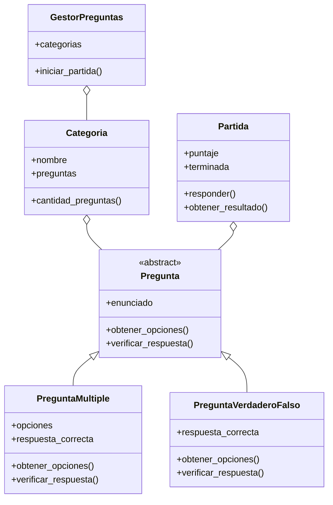

# Diagrama de clases 

El siguiente diagrama representa las principales clases del proyecto y sus relaciones.

## Explicación

- Pregunta: clase base de los tipos de preguntas.
- PreguntaMultiple: representa preguntas de selección múltiple.
- PreguntaVerdaderoFalso: representa preguntas de verdadero o falso.
- Categoria: organiza las preguntas por temas.
- Partida: controla el desarrollo y los resultados de una partida.
- GestorPreguntas: administra las categorías y preguntas.

**Nota:** verificar los atributos, métodos y relaciones con el código definitivo antes de entregar.
